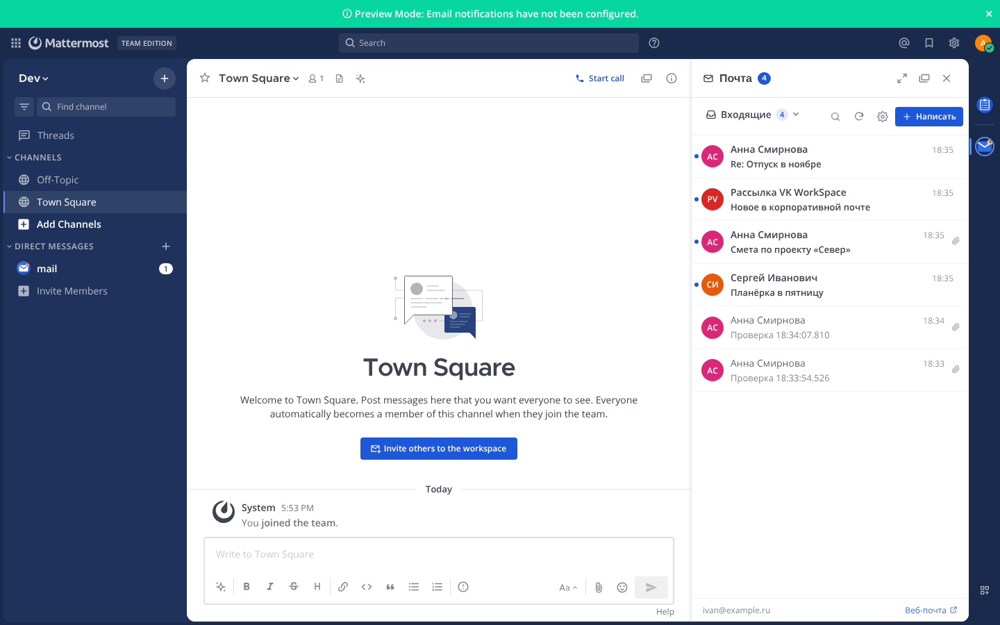
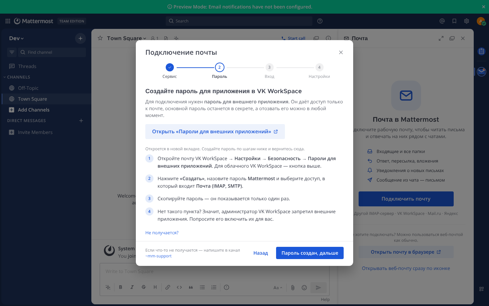
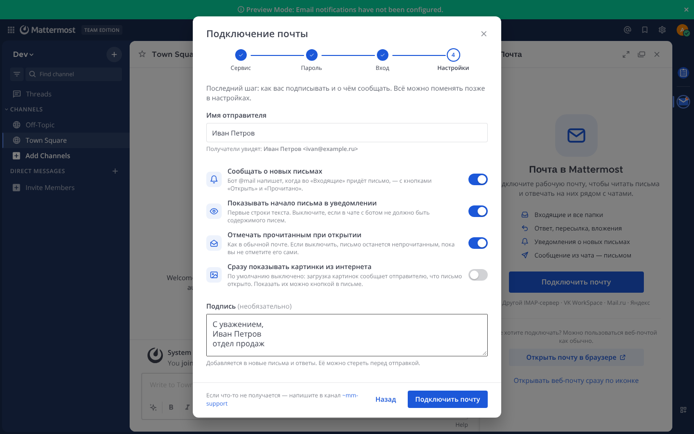
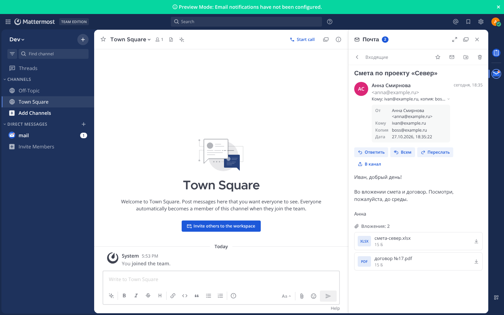
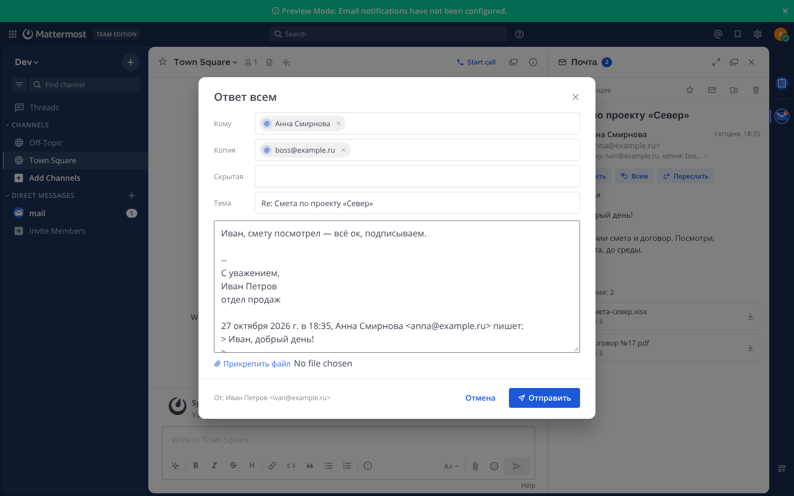
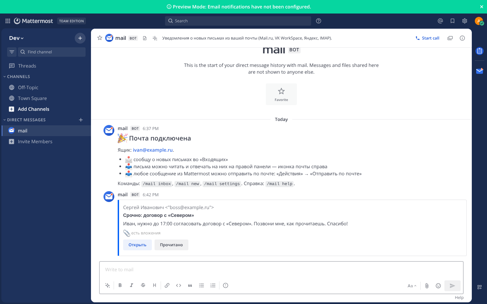
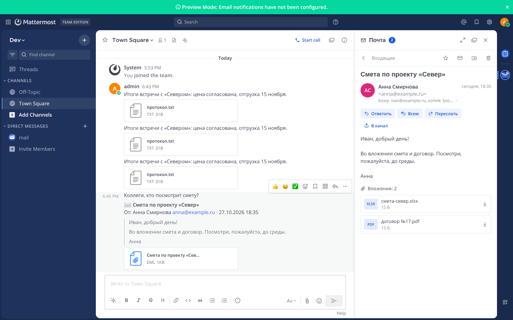

# Почта для Mattermost: VK WorkSpace, Mail.ru, Яндекс, IMAP

Рабочая почта прямо в Mattermost — на правой панели, рядом с чатами.
Сотрудник один раз подключает ящик через мастер по шагам и дальше просто
пользуется: читает письма, отвечает, пересылает, получает уведомления о новых
письмах от бота.

Плагин сделан по образцу [календаря](https://github.com/FLEXIY0/mattermost-plugin-mailru-calendar):
тот же мастер подключения через пароль приложения, то же шифрование паролей,
та же иконка на правой панели и проверка обновлений.



## Что умеет

- **Иконка на правой панели Mattermost** (App Bar). По клику открывается почта:
  «Входящие» и все папки, счётчики непрочитанных, поиск по отправителю,
  получателю и теме.
- **Чтение писем**: HTML-письма показываются в изолированной рамке — скрипты
  не запускаются, картинки из интернета скрыты до нажатия «Показать» (чтобы
  отправитель не узнал, что письмо открыто). Встроенные картинки (cid:)
  показываются сразу. Вложения скачиваются одной кнопкой. Понимает
  windows-1251, koi8-r и русские имена файлов.
- **Ответ, ответ всем, пересылка** — с цитатой, подписью и вложениями
  исходного письма. Ответ правильно встраивается в переписку
  (`In-Reply-To`, `References`), исходное письмо помечается «Отвечено».
- **Новое письмо**: получатели — коллеги из Mattermost (адрес подставится сам,
  даже если он скрыт настройками приватности) или любые адреса; копия,
  скрытая копия, вложения (можно перетащить файлы в окно), Ctrl+Enter — отправить.
- **Сообщение из чата — письмом**: «Действия» у любого сообщения →
  «Отправить по почте». Текст станет письмом, файлы — вложениями, в конце —
  ссылка на обсуждение в Mattermost.
- **Письмо — в канал**: кнопка «В канал» публикует письмо в текущем канале
  от вашего имени (тема, отправитель, текст цитатой и само письмо файлом .eml),
  чтобы обсудить его с командой.
- **Уведомления от бота `@mail`** о новых письмах во «Входящих» — с началом
  текста и кнопками «Открыть» (откроет письмо на панели) и «Прочитано».
- **Флажки, прочитано/непрочитано, перемещение по папкам, удаление** в
  корзину (из корзины — навсегда).
- **Можно без подключения**: иконка может просто открывать веб-почту в
  браузере (Mail.ru, Яндекс, корпоративную или любой свой адрес).
- **Команды** `/mail inbox` (непрочитанные — работает и в мобильном
  приложении), `/mail new`, `/mail sync`, `/mail settings`.

| Мастер подключения | Настройки |
|---|---|
|  |  |

| Письмо с вложениями | Ответ всем |
|---|---|
|  |  |

| Уведомление от бота | Письмо в канале |
|---|---|
|  |  |

## Поддерживаемая почта

| Сервис | Серверы | Где взять пароль приложения |
|---|---|---|
| **VK WorkSpace** (корпоративная почта) | `imap.mail.ru:993`, `smtp.mail.ru:465` для облака или серверы вашей установки (задаёт администратор) | Настройки почты → Безопасность → [Пароли для внешних приложений](https://account.mail.ru/user/2-step-auth/passwords/), доступ к Почте (IMAP, SMTP). Администратор VK WorkSpace может запретить внешние приложения. |
| **Mail.ru** (@mail.ru, @inbox.ru, @list.ru, @bk.ru) | `imap.mail.ru:993`, `smtp.mail.ru:465` (подставляются сами) | Там же. Нужен привязанный номер телефона. |
| **Яндекс** и Яндекс 360 | `imap.yandex.ru:993`, `smtp.yandex.ru:465` (подставляются сами) | В Почте: Настройки → Почтовые программы → включить IMAP и «Пароли приложений». Затем Яндекс ID → [Пароли приложений](https://id.yandex.ru/security/app-passwords) → «Почта». |
| **Любой IMAP/SMTP** — Exchange с IMAP, Dovecot, Zimbra, Gmail… | вводит пользователь или администратор | Зависит от сервера. |

Почему нужен пароль приложения: почтовые сервисы не пускают сторонние
программы по основному паролю. Пароль приложения отзывается в любой момент и
не раскрывает пароль от почты.

> Встроить сам сайт e.mail.ru в Mattermost нельзя: Mail.ru запрещает
> показывать свои страницы внутри других сайтов. Поэтому плагин работает с
> почтой по стандартным протоколам IMAP и SMTP — тем же, через которые почту
> читают Outlook, Thunderbird и телефоны, — и показывает её сам.

## Установка (для администратора)

Требования: Mattermost **9.0+** (проверено на 11.7.2), исходящие соединения с
сервера Mattermost до почтовых серверов (порты 993 и 465 или 587).

1. Скачайте `com.github.flexiy0.mail-<версия>-linux-amd64.tar.gz` из
   [Releases](https://github.com/FLEXIY0/M-mail-/releases) или соберите сами (см. ниже).
2. **Системная консоль → Плагины → Управление плагинами → Загрузить плагин**.
   Если загрузка выключена, включите `PluginSettings.EnableUploads`.
3. Включите плагин. Ключ шифрования создаётся автоматически.
4. Для VK WorkSpace on-premises укажите свои IMAP и SMTP-серверы в настройках
   плагина. Для облака менять ничего не нужно.
5. Сообщите команде: «нажмите иконку почты справа и следуйте мастеру».

### Настройки плагина

| Настройка | По умолчанию | Зачем |
|---|---|---|
| VK WorkSpace / Mail.ru / Яндекс / Другой IMAP | все включены | Какие сервисы показывать в мастере. |
| VK WorkSpace: IMAP-сервер, SMTP-сервер | `imap.mail.ru:993`, `smtp.mail.ru:465` | Для установки on-premises — свои серверы. Порт 993/465 — SSL/TLS, 143/587 — STARTTLS; тип можно задать явно: `mail.corp.ru:143/starttls`. Пользователи эти серверы поменять не могут. |
| Другой сервер: IMAP и SMTP по умолчанию | — | Подставляются в мастер. К этим серверам разрешено подключение, даже если они во внутренней сети. |
| Разрешить любые адреса во внутренней сети | выкл. | См. «Безопасность». |
| Сервис по умолчанию | VK WorkSpace | Если домен почты известен (@mail.ru, @yandex.ru…), сервис выбирается сам. |
| Как часто проверять новые письма | 1 минута | Для уведомлений плагин спрашивает у сервера только счётчики «Входящих» — один короткий запрос. |
| Максимальный размер вложений | 25 МБ | Суммарно в одном письме, не больше 50 МБ. |
| Подсказка в мастере | — | Например: «Вопросы — в канал ~techsupport». |

## Для сотрудников

1. Нажмите **иконку почты** на правой панели Mattermost → **«Подключить почту»**.
2. Выберите сервис, создайте пароль приложения по инструкции, вставьте его.
3. Проверьте имя отправителя, при желании добавьте подпись — готово.

| Команда | Что делает |
|---|---|
| `/mail` | открыть почту на правой панели |
| `/mail new [адрес]` | написать письмо |
| `/mail inbox` | непрочитанные письма во «Входящих» (работает и на телефоне) |
| `/mail web` | ссылка на веб-почту |
| `/mail connect` | мастер подключения |
| `/mail sync` | проверить почту сейчас |
| `/mail settings` | уведомления, подпись, имя отправителя, что открывает иконка |
| `/mail disconnect` | отключить почту и удалить сохранённый пароль |

**Мобильное приложение** Mattermost не показывает правую панель плагинов, но
уведомления от бота и `/mail inbox` работают. Подключать почту нужно с
компьютера или в браузере.

## Безопасность

- Письма **не хранятся** в Mattermost: плагин читает их с почтового сервера,
  когда пользователь открывает почту. В базе Mattermost лежат только настройки
  и пароль приложения — **зашифрованный** (AES-256-GCM), ключ — в настройках
  плагина. Смена ключа потребует переподключения.
- Для Mail.ru, Яндекса и VK WorkSpace адреса серверов зашиты в плагин или
  заданы администратором — их нельзя подменить из браузера.
- Подключения к адресам внутренней сети (localhost, 10.x, 192.168.x и т. п.)
  запрещены, кроме серверов, указанных администратором. Адрес проверяется
  после разрешения DNS, и соединение идёт на проверенный IP.
- Соединения только по TLS (SSL или STARTTLS). «Без шифрования» имеет смысл
  лишь для серверов во внутренней сети.
- HTML-письма показываются в рамке `sandbox` без скриптов и с политикой
  CSP; картинки из интернета загружаются только по кнопке. Вложения отдаются
  с `Content-Disposition: attachment` и `nosniff`, HTML и SVG браузер не
  откроет как страницу Mattermost.
- Если почта перестала принимать пароль (его отозвали), плагин **сразу
  прекращает** попытки входа, чтобы аккаунт не заблокировали, и один раз
  пишет пользователю, что нужно переподключиться.
- Отправка ограничена (60 писем в час на пользователя), чтобы украденная
  сессия Mattermost не превратила сервер в рассылку спама.
- `/mail disconnect` удаляет пароль и состояние с сервера Mattermost.

## Если что-то не работает

| Проблема | Что сделать |
|---|---|
| «Логин или пароль не подошли» | Нужен пароль **для внешнего приложения**, а не от почты, с доступом к Почте. Логин — полный адрес почты. |
| «Доступ из почтовых программ выключен» | Включите IMAP в настройках почты (Mail.ru, VK WorkSpace, Яндекс: «Почтовые программы»). |
| Чтение работает, отправка — нет | У пароля приложения может не быть доступа к SMTP. Создайте пароль с полным доступом к Почте. |
| «Почтовый сервер не отвечает» | Серверу Mattermost нужен исходящий доступ к портам 993 и 465 (587) почтового сервера. |
| «Адрес во внутренней сети запрещён» | Администратор: укажите сервер в настройках плагина. |
| Нет копии письма в «Отправленных» | Через несколько секунд после отправки плагин ищет письмо в папке «Отправленные» и, если сервер не сохранил копию сам, кладёт её туда. Если у ящика нет папки с ролью «Отправленные», копия не сохраняется. |

## Разработка

Локальный стенд — Mattermost 11.7.2, PostgreSQL и тестовый почтовый сервер
GreenMail с ящиками `ivan@`, `anna@` и `boss@example.ru` (пароль `app-password`):

```bash
docker compose up -d
# http://localhost:8065

# первый запуск: администратор и команда
docker compose exec mattermost mmctl --local user create \
  --email admin@example.com --username admin --password 'Admin_12345!' --system-admin
docker compose exec mattermost mmctl --local team create --name dev --display-name Dev
docker compose exec mattermost mmctl --local team users add dev admin

./build/dev-deploy.sh   # собрать и установить плагин в контейнер
```

В мастере выберите «Другой IMAP-сервер»: IMAP `greenmail:3143`, SMTP
`greenmail:3025`, «Без шифрования». Чтобы адрес внутренней сети Docker был
разрешён, укажите в настройках плагина «Другой сервер: IMAP/SMTP по
умолчанию» `greenmail:3143/none` и `greenmail:3025/none`. GreenMail принимает
любой пароль и доставляет письма между своими ящиками.

```bash
make            # проверки, тесты и сборка
make test       # тесты сервера и webapp
make dist       # собрать dist/com.github.flexiy0.mail-<версия>.tar.gz
GREENMAIL_HOST=localhost go test ./server/mailclient/   # + тест на живом GreenMail
```

- `server/mailclient` — IMAP/SMTP-клиент поверх go-imap v2 и go-smtp: защита от
  SSRF, таймауты, понятные коды ошибок, разбор MIME (кодировки, имена файлов,
  cid-картинки), сборка писем. Тесты поднимают настоящие IMAP- и SMTP-серверы
  в памяти.
- `server/*.go` — API для webapp, `/mail`, пул IMAP-соединений (одно на
  пользователя, закрывается через 3 минуты простоя), фоновая проверка новых
  писем и уведомления.
- `webapp/src` — иконка в App Bar, панель, просмотр письма, окно нового письма,
  мастер и настройки (React, TypeScript).

## Лицензия и благодарности

Apache License 2.0. Плагин основан на
[mattermost-plugin-mailru-calendar](https://github.com/FLEXIY0/mattermost-plugin-mailru-calendar)
— см. [NOTICE](NOTICE).
